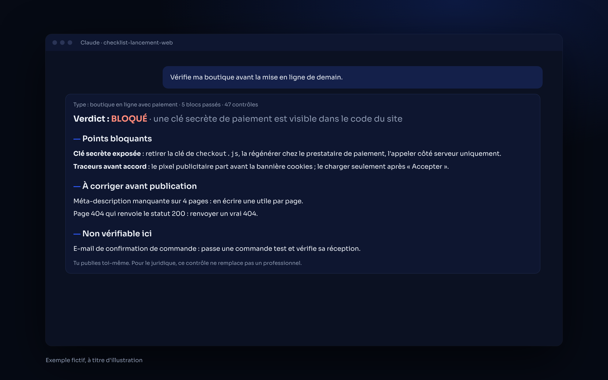
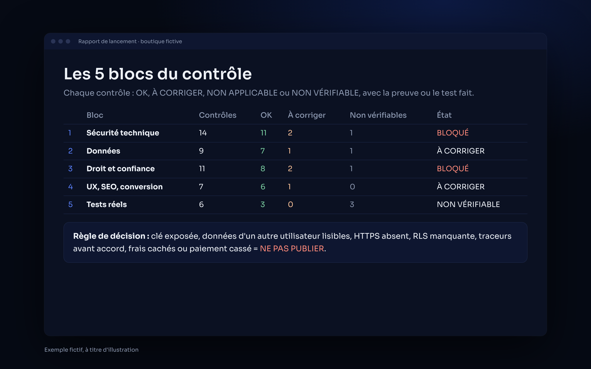

> **Ce dépôt est archivé et remplacé par [publication-sure](https://github.com/horizonchapter/publication-sure).**
> publication-sure reprend la checklist complète (sécurité, RGPD, vente, SEO, tests réels) et la fait tourner pour de vrai : scan de secrets, sondes locales, contrôle légal FR/UE, Lighthouse et liens, avec un verdict PRÊT / À CORRIGER / BLOQUÉ. Ce dépôt reste lisible en lecture seule.
> *Archived: replaced by [publication-sure](https://github.com/horizonchapter/publication-sure).*

<p align="center">
  
</p>

<p align="center">
  
  
  
</p>

# checklist-lancement-web — tout vérifier avant de publier

**Un skill Claude qui contrôle un site, une boutique, une app ou un SaaS avant sa mise en ligne : sécurité, données, droit, SEO, conversion et tests réels. Il rend un verdict clair et la correction exacte pour chaque problème.**
*A Claude skill that checks a website, store, app or SaaS before launch: security, data, legal, SEO and real-world tests.*

## ✦ Ce que fait le skill

| | |
|---|---|
| **Règle bloquante** | Clé secrète exposée, données d'un utilisateur lisibles par un autre, HTTPS absent, RLS manquante, traceurs avant accord, frais cachés, paiement cassé : **ne pas publier**. |
| **5 blocs** | Sécurité technique · Données (Supabase ou équivalent) · Droit et confiance (France / UE) · UX, SEO et conversion · Tests réels. |
| **Un statut par contrôle** | OK, À CORRIGER, NON APPLICABLE ou NON VÉRIFIABLE, avec la preuve ou le test fait. |
| **Vérifie lui-même** | Avec accès au code ou à la base, il contrôle directement. Sinon, il te donne le test exact à faire. |
| **Rapport final** | Verdict (PRÊT À PUBLIER, À CORRIGER, BLOQUÉ), points classés par gravité avec la correction et l'endroit, tests à faire toi-même. |
| **Ne publie rien** | Il vérifie et prépare ; la mise en ligne reste ta décision. |

## ✦ Aperçu

Un rapport sur une boutique fictive, puis le résumé par bloc :

<p align="center">
  
  
</p>

<p align="center"><sub><i>Exemple fictif, à titre d'illustration.</i></sub></p>

## ✦ Installation

**Télécharger** : bouton vert **Code → Download ZIP**, ou :

```bash
git clone https://github.com/horizonchapter/checklist-lancement-web.git
```

**Claude Code** (pour tous tes projets) :

```bash
cp -r checklist-lancement-web/skills/checklist-lancement-web ~/.claude/skills/
```

**Claude (app et web)** : importe le fichier [`checklist-lancement-web.zip`](checklist-lancement-web.zip) dans les réglages des skills de Claude.

## ✦ Utilisation

- « Vérifie ma boutique avant la mise en ligne. »
- « Passe la checklist de lancement sur ce SaaS avant la nouvelle version. »
- « Est-ce que mon site vitrine peut être publié ? »

Le skill détecte le type de projet (site vitrine, boutique, app avec comptes, SaaS avec paiement) et saute les contrôles qui ne s'appliquent pas, en le disant.

## ✦ Structure

```
checklist-lancement-web/
├── skills/checklist-lancement-web/SKILL.md   le skill
├── checklist-lancement-web.zip               le même skill, prêt à importer
└── assets/                                   bannière et aperçus
```

## ✦ Voir aussi

- [chiffrage-projet](https://github.com/horizonchapter/chiffrage-projet) : chiffrer le projet avant de le lancer.
- [grill-me](https://github.com/horizonchapter/grill-me) : solidifier le plan avant de construire.
- [horizon-aios](https://github.com/horizonchapter/horizon-aios) : la méthode de travail dont ce skill fait partie.

## ✦ Licence

[MIT](LICENSE). Ce contrôle aide à ne rien oublier ; pour le juridique (CGV, RGPD, mentions légales), il ne remplace pas un professionnel.
